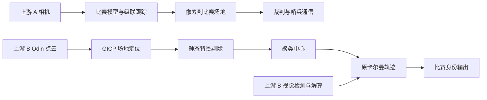

# 复用边界与模块调用图

| 上游模块 | 可借鉴或复用的能力 | 新工程处理 |
|---|---|---|
| 单目 driver/hik_camera | 海康采集 | 保留 SDK 边界，尚需硬件测试 |
| 单目 model/yolov8、tracker | 推理、级联匹配思路 | 不加载比赛模型；提供工业 ONNX 适配器、新目标 ID 跟踪 |
| 单目 transform/ray_renderer | 基于场地网格的射线投影 | MVP 使用标定地面交点，非平地需后续网格模型 |
| 激光 localization | GICP 地图定位 | 作为可选上游独立节点；需重建仓储地图与编译验证 |
| dynamic_cloud、cluster | 静态背景剔除、欧氏聚类 | 新 Python 离线适配器，参数化地面和背景距离 |
| kalman_filter | 原后融合基线 | 保留原代码；新 fixed_fusion 不是原 B3 |
| referee、dart/fly、阵营映射 | 比赛通信与规则 | 不进入工业主线 |
| build/install/log | 原机生成产物 | 不复用为可移植发布物 |

新工程：标定观测/JSONL → 时间与坐标校验 → 单源或质量融合 → 几何可见性与有限跟踪 → 概率轨迹风险 → 事件日志/CSV/本地看板。ROS 2 包为可选传输层。独立 GT 仅进入评测，不进入估计器。
